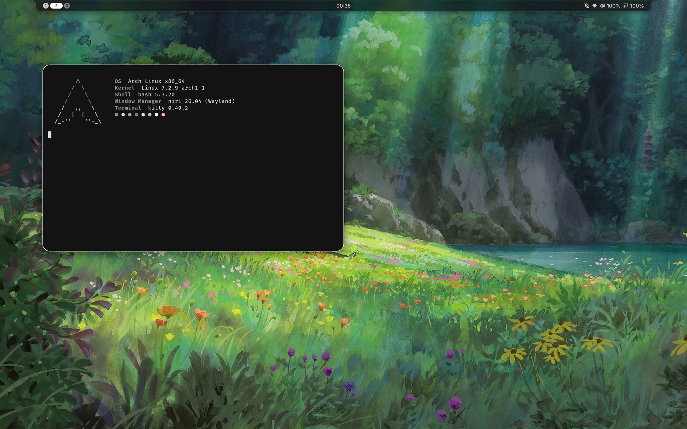

# dots

A minimal Arch Linux desktop built around **niri** and **Noctalia**.
Rounded windows, a quiet translucent bar, and a monochrome palette generated
from the wallpaper.



The repo root mirrors `$HOME`: `.config/`, `.bashrc`, `.bash_profile`, and
`Pictures/` are the files to copy. Everything else (`README.md`, `LICENSE`,
`assets/`, `packages/`, `examples/`) is repository material and stays out of
your home. There is no installer, so take all of it or just the parts you want
and edit the few machine-specific bits.

## Contents

| Path | What it is |
| :--- | :--- |
| [.config/niri/](.config/niri/) | Compositor: layout, animations, window rules, keybinds, outputs |
| [.config/noctalia/](.config/noctalia/) | Shell: bar, panels, launcher, idle, wallpaper, color templates |
| [.config/kitty/](.config/kitty/) | Terminal and its Noctalia palette |
| [.config/gtk-3.0/](.config/gtk-3.0/) · [gtk-4.0/](.config/gtk-4.0/) | GTK theme import and generated colors |
| [.config/fontconfig/fonts.conf](.config/fontconfig/fonts.conf) | Inter, FiraCode, and Noto CJK fallbacks |
| [.config/starship.toml](.config/starship.toml) · [fastfetch/](.config/fastfetch/) · [kdeglobals](.config/kdeglobals) | Prompt, fetch output, Qt colors |
| [.config/environment.d/](.config/environment.d/) | PATH and editor for systemd user services |
| [.bashrc](.bashrc) · [.bash_profile](.bash_profile) | Bash, with optional fzf / Starship / mise |
| [Pictures/Wallpapers/](Pictures/Wallpapers/) | The wallpaper |
| [packages/](packages/) | Arch package lists |
| [examples/](examples/) | Optional laptop display layout |

## Dependencies

The desktop needs the Arch packages listed in
[packages/base.txt](packages/base.txt): niri, Noctalia, kitty, PipeWire,
portals, the GTK theme, and fonts. [packages/optional.txt](packages/optional.txt)
adds the CLI tools used by the terminal config (fastfetch, btop, fzf, mise,
Neovim, …) and can be skipped.

Noctalia must be the **v5 `noctalia` package** from Arch's extra repository.
The v4 `noctalia-shell` package reads a different, incompatible config format.
These dotfiles were tested with niri 26.04, Noctalia 5.2.1, and kitty 0.49.2.

## Install

```bash
git clone https://github.com/nochinsky/dots.git
cd dots

sudo pacman -Syu --needed $(cat packages/base.txt)
sudo pacman -Syu --needed $(cat packages/optional.txt) # optional
```

Back up what already exists:

```bash
tar -czf ~/dots-backup-$(date +%F).tar.gz ~/.config ~/.bashrc ~/.bash_profile ~/Pictures 2>/dev/null
```

Then copy the files. These commands merge directories and overwrite same-named
files; they leave everything else in your home alone.

```bash
mkdir -p ~/.config ~/Pictures
cp -r .config/. ~/.config/
cp .bashrc .bash_profile ~/
cp -r Pictures/. ~/Pictures/
```

Set the GTK preferences once from your graphical session:

```bash
gsettings set org.gnome.desktop.interface gtk-theme 'adw-gtk3-dark'
gsettings set org.gnome.desktop.interface icon-theme 'Adwaita'
gsettings set org.gnome.desktop.interface color-scheme 'prefer-dark'
```

Check the configs, then log into the **niri** session with your display manager
(or run `niri-session` from a TTY):

```bash
niri validate
noctalia config validate
```

The niri config starts Noctalia itself with `spawn-at-startup "noctalia"`.

## Displays and keyboard

niri picks the mode and scale for each output automatically. The shipped
[outputs.kdl](.config/niri/noctalia/outputs.kdl) therefore only contains
comments; see what your machine reports with:

```bash
niri msg outputs
```

Then add an `output` block to the installed copy. The
[laptop example](examples/laptop-outputs.kdl) is a 2880×1800 panel at 1.5 scale.

The keyboard layout comes from the system (`localectl`) or an `xkb` block under
`input.keyboard` in niri. `Mod` is Super.

## Keybindings

| Keys | Action |
| :--- | :--- |
| `Super + Return` | Kitty |
| `Super + Space` | Launcher |
| `Super + E` | Nautilus |
| `Super + D` | Control center |
| `Super + I` | Noctalia settings |
| `Super + P` | Power menu |
| `Super + L` | Lock |
| `Super + V` | Clipboard |
| `Super + W` / `Super + Shift + W` | Next / random wallpaper |
| `Super + Shift + C` | Toggle idle inhibitor |
| `Super + Tab` | Overview |
| `Alt + Tab` / `Alt + Shift + Tab` | Recent windows on this output |
| `Super + arrows` | Focus window |
| `Super + Shift + arrows` | Move window |
| `Super + 1…9` | Focus workspace |
| `Super + Shift + 1…9` | Move column to workspace |
| `Super + F` / `Super + M` | Fullscreen / maximize column |
| `Super + T` | Toggle floating |
| `Super + Y` | Toggle tabbed column |
| `Super + Q` | Close window |
| `Print` / `Ctrl + Print` | Screenshot region / fullscreen |
| `Super + Shift + /` | Show hotkey overlay |
| `Super + Shift + Q` | Quit niri |

Volume, media, microphone, and brightness keys use Noctalia's IPC, so they need
the shell running. The full list lives in
[binds.kdl](.config/niri/noctalia/binds.kdl).

## Notes

- **Generated files.** Noctalia writes the palette files when the wallpaper or
  theme changes: `~/.config/niri/noctalia.kdl`,
  `~/.config/kitty/themes/noctalia.conf`, the `noctalia.css` files under
  `gtk-*`, and the palette block in `starship.toml`. They are shipped so the
  desktop has colors before the shell starts, but changes made by hand will be
  overwritten.
- **Theme template scope.** `[theme.templates]` in
  [config.toml](.config/noctalia/config.toml) enables Noctalia's `gtk3`, `gtk4`,
  `kitty`, `niri`, and `starship` templates, so the shell may edit those app
  configs on its own. Set `builtin_ids = []` there to opt out.
- **GUI overrides.** Noctalia's Settings window writes
  `~/.local/state/noctalia/settings.toml`, which loads after `config.toml`.
  Remove that file to fall back to this declarative config. If a first-run
  setup prompt appears, keep the imported theme and bar.
- **Wallpaper.** The default is `~/Pictures/Wallpapers/scenery-96l5xd.webp`, set
  in the Noctalia config. `wallpaper.directory` is left empty, so the picker
  browses `~/Pictures`. Use your own image and update the path.
- **Qt colors.** [kdeglobals](.config/kdeglobals) supplies a palette, but a Qt
  app still needs a platform theme (for example `qt6ct` or the KDE integration)
  to read it.
- **Shell.** [.bashrc](.bashrc) adds `~/.local/bin` and mise's shims to `PATH`,
  sources Cargo when present, and enables fzf, Starship, and mise only if they
  are installed. It sets `EDITOR=nvim`; change that if you use another editor.
- **Session environment.** [.config/environment.d/](.config/environment.d/)
  gives systemd user services the same `PATH`; it applies after a new login.
- **Clipboard and keyring.** Noctalia's encrypted clipboard history needs a
  Secret Service provider such as `gnome-keyring` unlocked in your session.
- **Idle.** Lock and screen-off both trigger after 300 seconds; idle does not
  suspend.

## Credits

- [niri](https://github.com/niri-wm/niri) — compositor.
- [Noctalia](https://github.com/noctalia-dev/noctalia) — shell and color templates.
- [kitty](https://sw.kovidgoyal.net/kitty/) — terminal.
- [adw-gtk3](https://github.com/lassekongo83/adw-gtk3) — GTK 3 theme.
- [Inter](https://rsms.me/inter/), [Fira Code](https://github.com/tonsky/FiraCode),
  [Nerd Fonts](https://www.nerdfonts.com/), and [Noto](https://notofonts.github.io/) — fonts.
- Wallpaper: [Wallhaven #96l5xd](https://wallhaven.cc/w/96l5xd) by **RevanLord**.

## License

The configs and documentation are [MIT](LICENSE). The wallpaper and the
screenshot are excluded from that license; their creators retain the rights.
